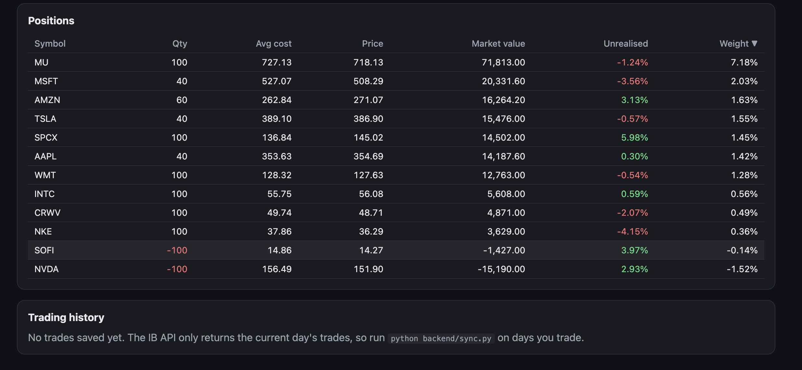

Portfolio analytics tool, useful for assessing risk and minimizing drawdown.

## File structure.
backend:
backend/sync.py: Pulls data(trades, open positions, avg prices, etc.) from IBKR gateway, puts into a local SQLite database through backend/storage.py.

backend/analytics.py: does all calculations, including portfolio correlations, daily simple returns, Net Asset Value. 

frontend:
Stack: Vite, React 19, TypeScript and Recharts for charts, with oxlint for linting.
Scripts: npm run dev, npm run build (type-checks, then builds) and npm run lint.
API address: http://127.0.0.1:8000.

tests:
test analytics calculations with sample numbers to check if results fit expectations. Keep in case changes are made to code for future checking.

backend/main.py, backend/routers: puts results through FASTAPI
## Analytics decisions
- Daily PnL comes from IB's net liquidation value (NAV) recorded at each day's sync (run it after the close for an end-of-day figure): PnL = change in NAV minus deposits/withdrawals. NAV history builds one row per day that `sync.py` runs.
- Returns: both are reported.
- Time-weighted (TWR): daily NAV_t / (NAV_{t-1} + flow_t) - 1, chain-linked. Cash flows are assumed to arrive at the start of the day.
- Money-weighted (MWR): internal rate of return over the whole period. It equals the simple return when there are no cash flows.
- Cost basis: IB's own realised PnL per trade (from the commission report). 
- Portfolio std (ex-ante): sqrt(w' Σ w), where w = market value / NAV for today's holdings (cash has zero volatility) and Σ is the covariance of about 1 year of daily returns. Annualised with 252 days. Realised std from NAV returns is shown once there are 20 days of history.
- Sharpe ratio: mean(daily TWR - daily risk-free) / std(daily TWR) * sqrt(252), in `backend/analytics/performance.py`. Needs 20+ days of NAV. Set the annual risk-free rate with `RISK_FREE_RATE` in `.env` (default 0, e.g. 0.045).
- Correlation: Pearson correlation of daily returns of the holdings over the same price window.

Note: This tool may only be run with an ibkr gateway logged into the trading account and running in background to provide API connection. 

Current version only works for IBKR gateway paper accounts. 
Port numbers for different accounts listed below:
IBKR gateway live: 4001 
IBKR gateway paper: 4002
IBKR TWS live: 7496
IBKR TWS paper: 7497

Edit in env_config.py

Statistics such as portfolio std, Sharpe Ratio, and cumulative PnL are not shown in images below due to insufficient data, as the paper account used is new. 

## Screenshots

### Overview: NAV, exposure, volatility and returns

### Positions

### Weights and correlation of daily returns

