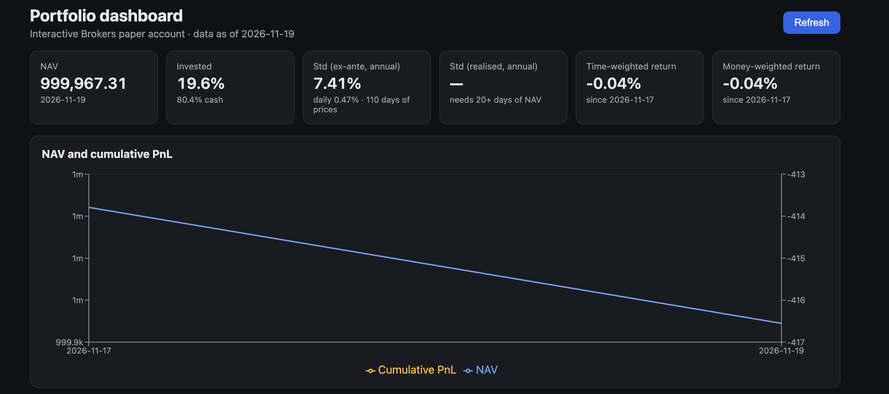
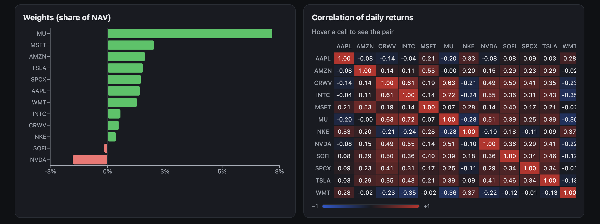

Portfolio analytics tool, useful for assessing risk and minimizing drawdown.
## Screenshots

### Overview: NAV, exposure, volatility and returns

### Positions

### Weights and correlation of daily returns

## File structure.
backend:
backend/sync.py: Pulls data(trades, open positions, avg prices, etc.) from IBKR gateway, puts into a local SQLite database through backend/storage.py.

backend/analytics.py: does all calculations, including portfolio correlations, daily simple returns, Net Asset Value. 

frontend:
Stack: Vite, React 19, TypeScript and Recharts for charts, with oxlint for linting.
Scripts: npm run dev, npm run build (type-checks, then builds) and npm run lint.
API address: http://127.0.0.1:8000.

tests:
test analytics calculations with sample numbers to check if results fit expectations. Keep in case changes are made to code for future checking.

backend/main.py, backend/routers: puts results through FASTAPI

Note: This tool may only be run with an ibkr gateway logged into the trading account and running in background to provide API connection. 

Current version only works for IBKR gateway paper accounts. 
Port numbers for different accounts listed below:
IBKR gateway live: 4001 
IBKR gateway paper: 4002
IBKR TWS live: 7496
IBKR TWS paper: 7497

Edit in env_config.py

Statistics such as portfolio std, Sharpe Ratio, and cumulative PnL are not shown in images below due to insufficient data, as the paper account used is new. 

